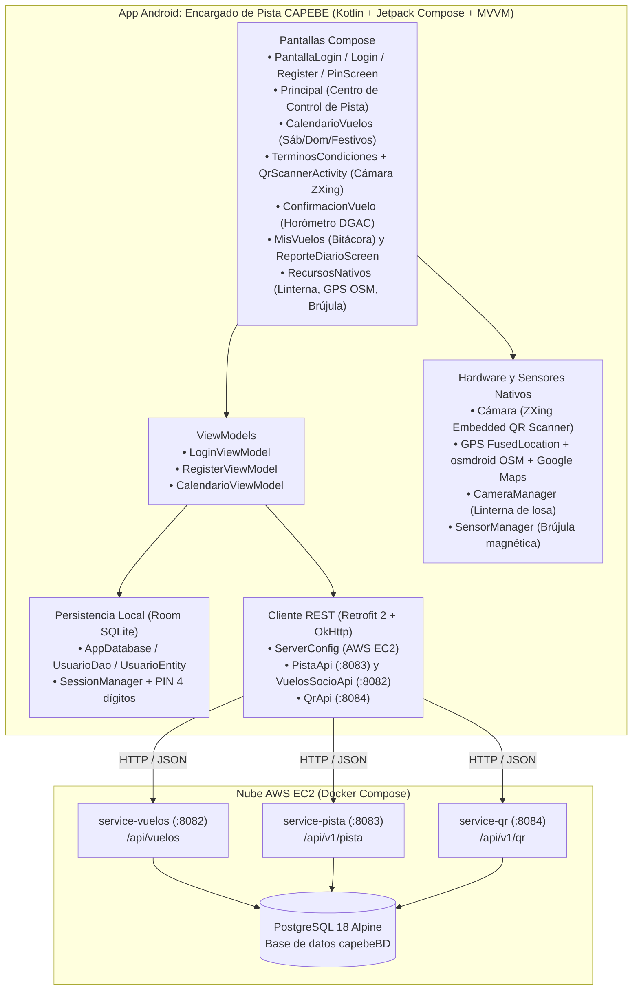
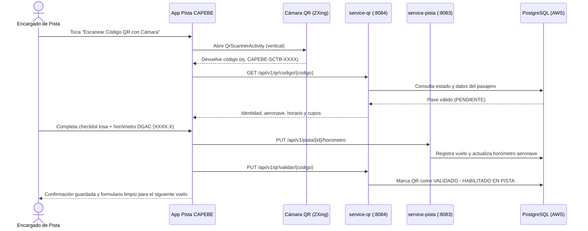

# Diagramas de Arquitectura — App Encargado de Pista CAPEBE

Documento técnico para `/documents` — **Club Aéreo del Personal del BancoEstado (CAPEBE)**.

---

## 1. Arquitectura General (Android MVVM + SQLite + Retrofit + AWS EC2)

---

## 2. Flujo de Validación QR y Habilitación en Pista

