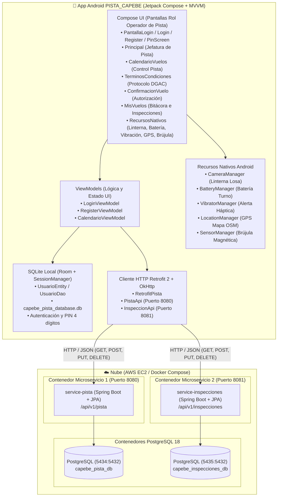
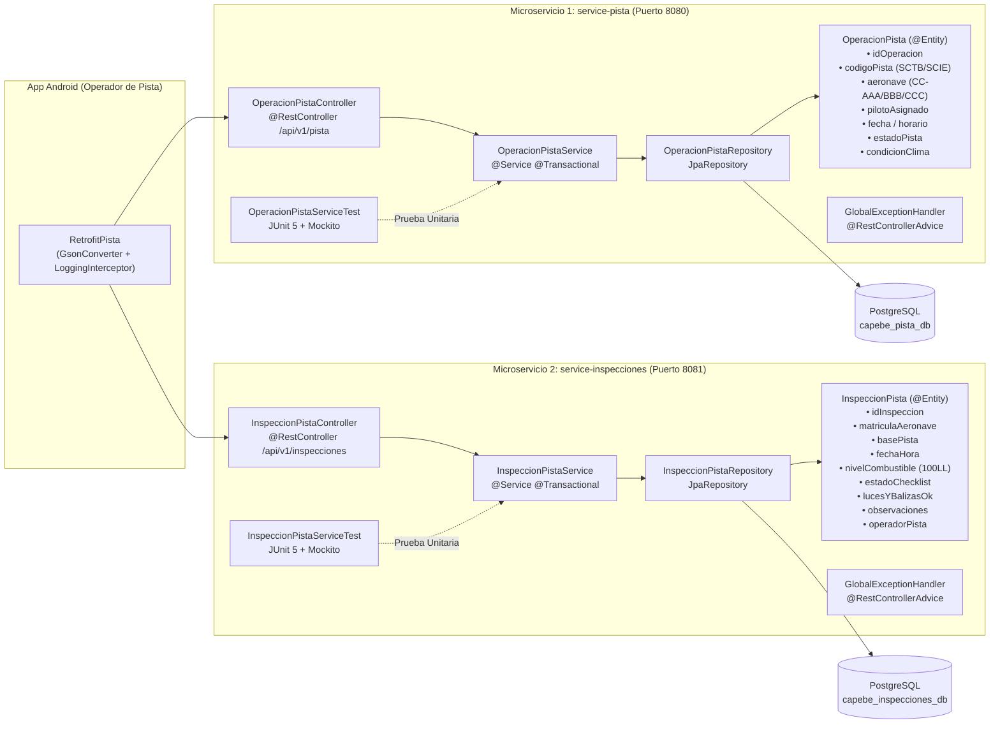

# Diagramas de Arquitectura - Proyecto CAPEBE (Rol Operador de Pista)

Documento preparado para la rama `/documents` según la **Rúbrica Experiencia 3 - 2026**.

---

## 1. Diagrama de Arquitectura del Proyecto (MVVM + SQLite + Retrofit + Cloud)

---

## 2. Diagrama de Arquitectura de Microservicios (Spring Boot + JUnit 5 + PostgreSQL)

